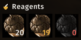
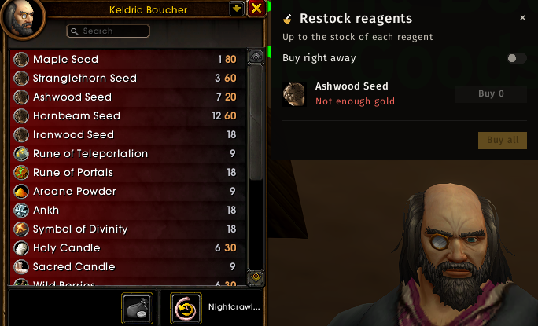
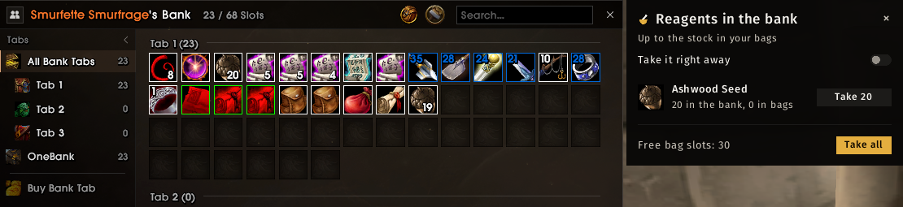
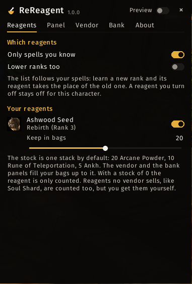

# ReReagent: Class Reagents Restock

Counts the reagents your class spells use in WoW Forever and restocks them at the vendor and from the bank. A druid sees Ironwood Seed for Rebirth, a mage sees Rune of Teleportation and Arcane Powder, a rogue sees Flash Powder and the vials and dust for poisons.

## What it tracks

The addon reads your spells and lists every reagent they use: Ankh for Reincarnation, Symbol of Divinity for Divine Intervention, Sacred Candle for Prayer of Fortitude, Soul Shard for a warlock's stones and demons, Deathweed and Crystal Vial for Deadly Poison. The reagents come from the Forever client data, so a spell Forever changed is listed the way Forever has it.

- **Only spells you know** (on by default). Turn it off to also see the reagents for spells the trainer teaches at your level, so you can buy them before the visit.
- **Lower ranks too** (off by default). Some spells take another reagent at each rank: Rebirth takes Maple Seed at rank 1 and Ironwood Seed at rank 5, Gift of the Wild takes Wild Berries and then Wild Thornroot. By default only the reagent of your highest rank is tracked. Turn this on if you still cast the lower ranks and want their reagents too.
- Every reagent on the Reagents tab has its own switch, so you can drop the ones you don't need. Your choice is kept per character.

When you learn a new rank, its reagent takes the place of the old one. At level 60 with Rebirth rank 5 the panel shows Ironwood Seed, not the Hornbeam Seed you used before.

## The panel

A small panel with an icon for each reagent and how many you carry: amber below your stock, red at 0. Hover an icon to see the stock, how many are in the bank and which spells need it.

The stock is one stack by default (20 Arcane Powder, 10 Rune of Teleportation, 5 Ankh, 100 Symbol of Kings) and you can change it for each reagent. With a stock of 0 the reagent is only counted. Soul Shards and other reagents no vendor sells are counted too, but you get them yourself.

The panel shows always (the default), only when you are short of something, only in combat, or never. Drag the title line or an icon to move it, middle-click to put it back, right-click for the settings.

## Vendor

When you talk to a vendor who sells your reagents, a panel next to the window lists what you are short of, up to the stock. Reagents in the bank count toward it; switch off "Count reagents in the bank" on the panel or on the Vendor tab to buy the full stock for your bags.

- **Buy all** buys every row, one stack at a time. If you can't pay for all of it, the row says how many you can pay for.
- Turn on "Buy right away" to skip the click.

## Bank

When you open the bank, a panel next to it lists the reagents your bags are short of. **Take all** moves them into your bags, splitting stacks so you get exactly the stock. Reagents for lower ranks you don't track stay in the bank. Turn on "Take it right away" to skip the click.

Both panels sit to the right of their window and follow it, also when a bag addon replaces the bank window. They share the space with the panels of the other Re addons. On the Vendor and Bank tabs you can attach the panel to the window or to another addon's panel, to the right, left, below or above. Drag a panel by any empty spot to shift it, middle-click to put it back.

## Settings

`/reagents` (or `/rereagent`) opens the settings:

- **Reagents** has "Only spells you know", "Lower ranks too" and a block for each reagent with its switch and how many to keep.
- **Panel** sets when the panel shows, reagents you are out of, icon size, spacing, row or column, the title line, the count, lock, both backgrounds, the minimap button and the language.
- **Vendor** has "Shopping list at the vendor", "Buy right away", "Count reagents in the bank" and where the panel sits.
- **Bank** has "Take reagents from the bank", "Take it right away" and where the panel sits.

## Other Re addons

Panels like this one for the other things you carry, with the same restock at the vendor and the bank:

- [ReScroll](https://www.curseforge.com/projects/1812247) shows which scroll buffs you are missing, applies them with one button and restocks scrolls ([GitHub](https://github.com/Jagerente/ReScroll)).
- [RePotion](https://www.curseforge.com/projects/1815534) gives you one button for health potions and one for mana potions, and restocks them ([GitHub](https://github.com/Jagerente/RePotion)).
- [ReFood](https://www.curseforge.com/projects/1816338) eats and drinks the strongest food you carry, reminds you of Well Fed and restocks food at the vendor ([GitHub](https://github.com/Jagerente/ReFood)).
- [ReWeapon](https://www.curseforge.com/projects/1816469) puts sharpening stones, oils and poisons on your weapons with one button per hand and restocks them ([GitHub](https://github.com/Jagerente/ReWeapon)).
